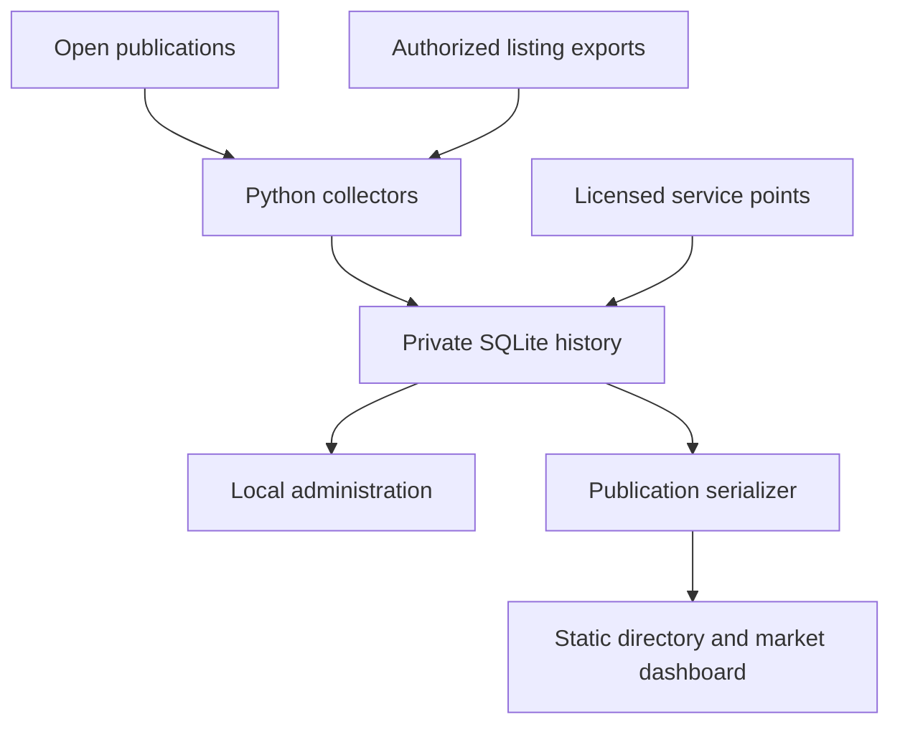

# Architecture

- **Collection.** Each provider has a separate configuration and run status. NCSI uses the publication index and known reports. MOHUP uses the English open-data catalog and handles both CSV layouts observed in the catalog. OSM loads the existing licensed point extract or an operator-supplied replacement. Authorized JSON feeds and manually approved JSON imports use the same validation path. A failed source preserves earlier results and the other sources continue. Retry limits, size budgets, host allowlists and independent release records apply.
- **Storage.** Python writes normalized facts into SQLite with foreign keys and WAL. Lending terms, photographs, personal contacts and raw official microdata are outside the model. Listing observations retain separate collection dates, verification and publication dates. Every valid price is stored against its observation. API JSON is separate from the private schema. Controls for authorized feeds are maintained on the office host.
- **Quality.** Hard structure failures reject individual rows. Other fields retain nulls and explainable flags. Candidates start pending. Identical URLs and corroborated similarity can suggest duplicates. Only manual review assigns a canonical property group. Corrections enter as later observations. Statistical comparisons require at least eight advertised OMR or same-currency records within a wilayat, property class, deal and rental period. Median absolute deviation and IQR flag extremes. A degenerate distribution uses a 25% relative difference. A price ratio of 1.5 or more triggers a separate time-series flag for comparable price bases. Flags are review signals.
- **Public data.** Source authorization and row approval are both required. URLs use reviewed HTTPS hosts and are published without query strings. Private notes and descriptions stay internal. Map locations are generalized to roughly 1 km. Nearby service distances use the public generalized location and the Haversine formula. The map uses Leaflet and OSM tiles. Licensed POI data retain separate ODbL attribution. Official market aggregates are stored and presented separately from advertisement measures.
- **Market.** Monthly advertised price summaries take the latest reading per listing per month and segment by provider, property type, deal, currency and rental period. A rental period must be explicit. Coverage and counts are presented alongside trends. First public observation uses observation time. Observed duration uses dated readings within the selected period. Confirmed duplicate groups count once in the estimate. Unmatched records each count once. Below-ground or environmental suitability requires an independently sourced future layer.
- **Growth.** Initial deployment assumes one office collection job and a lightweight review workload. Candidate comparisons can be quadratic within a dense wilayat, property class and deal block. Before large-scale production, benchmark with licensed representative source volumes and introduce indexed blocking and geographic buckets. Move the same entities into PostgreSQL using a versioned schema migration. Replace nearest-point loops with PostGIS geography indexes and `ST_DWithin`. Map OMR to NUMERIC, UTC values to timestamptz and SQLite JSON text to JSONB. Validate counts, foreign-key consistency, price history, latest records and candidate review history before cutover.
- **RAI integration.** `schema_version=1` in the vetted snapshot is the current exchange boundary. Stable source ID, source listing identity, canonical grouping, measurement time, definition, unit and basis support a future interface to the Statistical Intelligence Core. A service connection remains outside this release.
